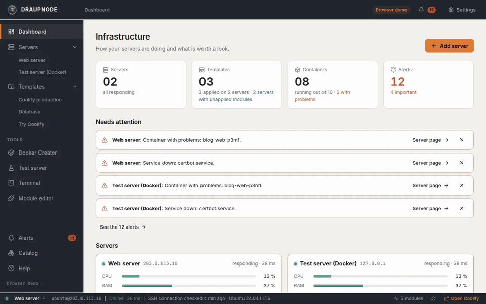
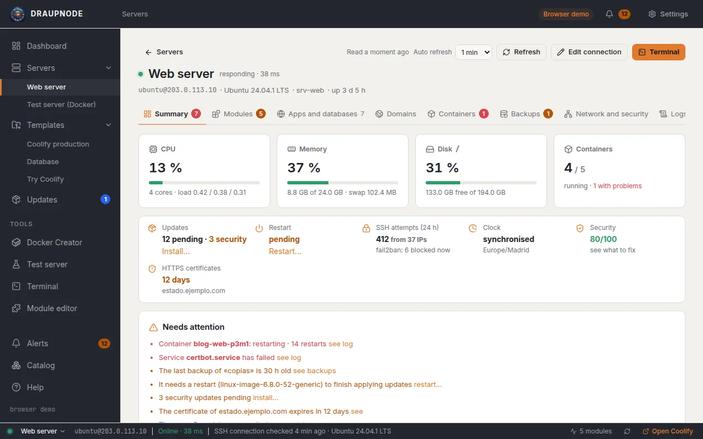
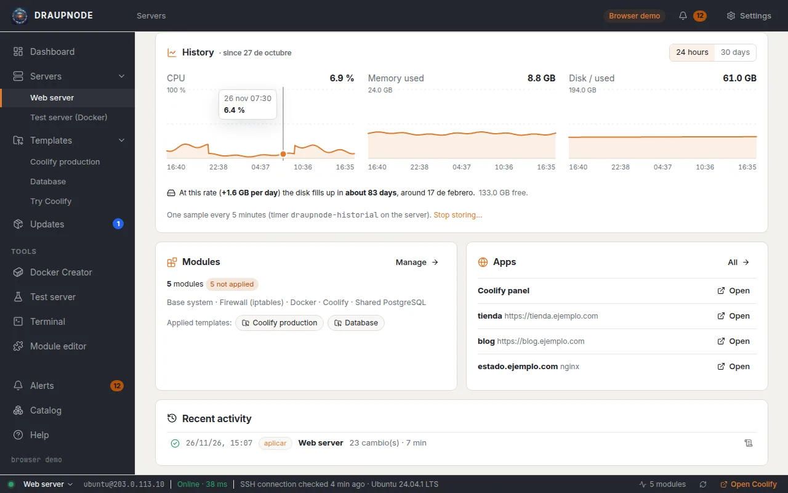
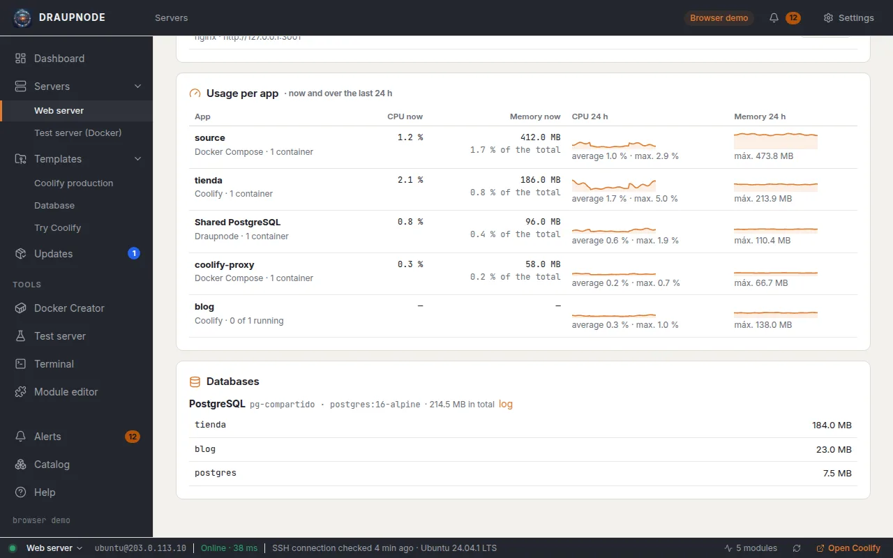
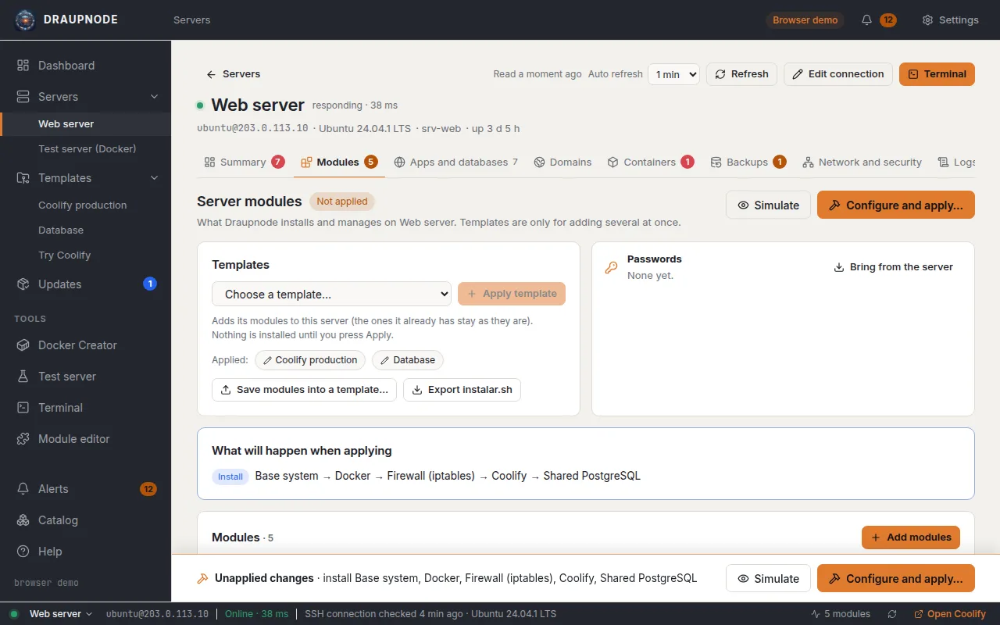
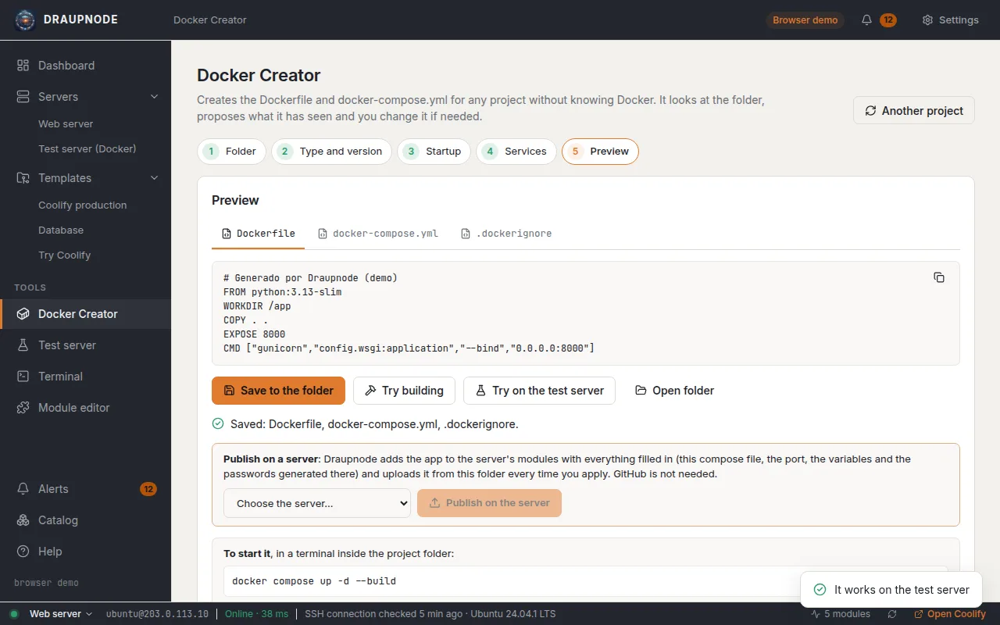
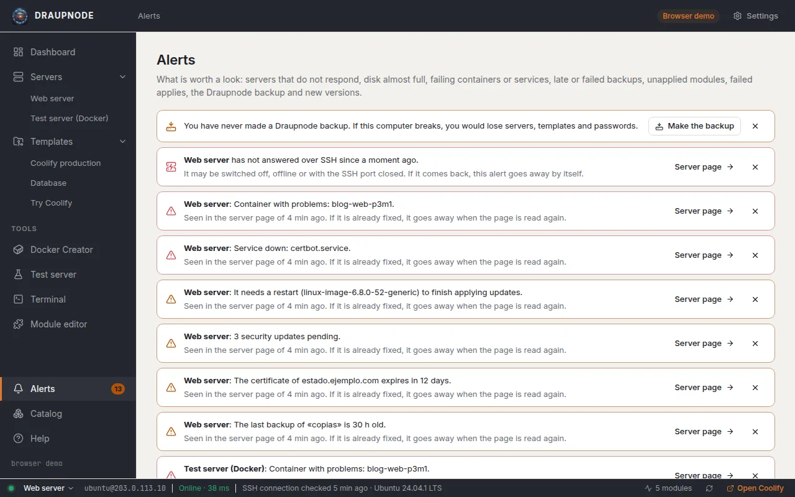

# Draupnode

[Español](README.md) · **English**

> In Norse mythology, **Draupnir** is the golden ring forged by the dwarves Brokkr and Eitri:
> every ninth night eight identical rings drop from it.
> **Draupnode** does the same with servers: you describe once what you want and it forges it on any Linux machine, from scratch.

A desktop application (Windows, macOS and Linux) to prepare and watch over Linux servers:
you add your servers over SSH, choose the **modules** you want on each one (Docker, Caddy or nginx, restic backups,
WireGuard, your apps from Git or from a folder, Vaultwarden, Immich…) and Draupnode installs them with
**Ansible**, or generates **a single `instalar.sh`** for you. Then it shows you how each server is doing and warns you
about what is worth a look.

<p align="center"></p>

**Everything is local.** There is no Draupnode server: the configuration lives on your computer, the passwords in the
system keyring or in an encrypted vault, and the only thing that goes out is the SSH connection to *your* servers (and,
if you leave it on, an anonymous request to GitHub to check for a new version).

**Everything is open source**, including what it installs.

**In English and Spanish**: the interface, the help, the messages and the modules (Settings → Language; the first
time it uses the system's language).

## Download

The installers for each version are in [Releases](../../releases):

| System | File |
|---|---|
| Windows | `draupnode-X.Y.Z-windows-amd64-instalador.exe` (or the `.zip` with the bare `.exe`) |
| macOS (Intel and Apple Silicon) | `draupnode-X.Y.Z-macos-universal.dmg` |
| Ubuntu / Debian | `draupnode_X.Y.Z_amd64.deb` (`sudo apt install ./draupnode_X.Y.Z_amd64.deb`) |
| Other Linux | `draupnode-X.Y.Z-linux-amd64.tar.gz` (needs GTK 3 and WebKitGTK 4.1) |

The installers are not signed: Windows (SmartScreen) and macOS (Gatekeeper) will warn you the first time.
On macOS: right-click Draupnode → Open. On Windows: «More info» → «Run anyway».

## What it does

- **Servers**: added over SSH (OpenSSH, PEM or PuTTY key, with or without a passphrase, or user and password) with
  verified fingerprints, and a **page** for each one with tabs:
  - **Summary**: CPU, memory, disk, containers, updates, pending restart, SSH attempts, clock,
    certificates and what «Needs attention».
  - **History**: a timer on the server stores CPU, memory, disk and what each app uses every 5 minutes
    (even when Draupnode is closed). 24-hour or 30-day charts and **when the disk will fill up** at this rate.
  - **Apps and databases**: addresses (also Coolify's and the nginx/Caddy sites), **usage per app** (its
    containers added up) and databases with their size.
  - **Containers** (stop, start, see logs, clean Docker), **Backups**, **Network and security** (ports,
    firewall, IPs trying to get in, «Install updates» and «Restart») and **Logs**.
- **Server modules**: tick what you want, **simulate** it (what would change, without touching anything) and **apply** it.
  Passwords are generated on the server itself. Each module can be uninstalled, with or without its data, and
  **«Uninstall everything»** leaves the server as freshly prepared.
- **Templates**: sets of modules with their configuration to add them all at once to any server.
- A **catalog** of 50 open-source modules, with their website, source code and licence, and a **guide to test each one**
  on the test server (steps and what you should see), with a list to tick off the ones you have checked:
  - **System and network**: base, firewall, secure SSH with fail2ban, exact time (chrony), WireGuard, Caddy, nginx, AdGuard.
  - **Security**: CrowdSec, Lynis, ClamAV, AIDE, auditd, Trivy, Keycloak, OpenBao.
  - **Containers and Kubernetes**: Docker, Coolify, Portainer, image registry, Kubernetes (k3s with Helm),
    Argo CD and OpenTofu (the free continuation of Terraform).
  - **Databases**: shared PostgreSQL, MariaDB and Valkey (the free continuation of Redis), and Adminer.
  - **Backups and monitoring**: restic with a destination on another server, Prometheus + Grafana, Loki, alerts to your
    phone, Uptime Kuma, Healthchecks, ntfy, Dozzle and Cockpit.
  - **Apps**: Nextcloud, Vaultwarden, Immich, Jellyfin, Navidrome, Paperless-ngx, Forgejo, Syncthing, Samba, Wiki.js,
    Vikunja, Umami and «Your app».
- **Custom module editor** (CodeMirror) to create your own or copy a built-in one, and **export and import them**
  (a `.draupnode-modulo` file): when importing, Draupnode checks that it is complete and shows you what it does on the
  server (tasks, commands, downloads and anything sensitive) before accepting it.
- **Your apps**: the «Your app» module deploys your `docker-compose.yml` from a Git repository or **from a folder
  on your computer** (no need to know git), reads the variables it needs and generates its keys. **Docker Creator**
  writes the Dockerfile and compose file for your project (Python, Node, Java, PHP, Go, web) and tries it on a
  **test server** (Ubuntu in Docker on your computer).
- **Backups**: daily restic, «Bring backups to this computer», a destination on another server (append-only
  rest-server, with rotation) and restoring from the app.
- **Alerts** in one place: servers that do not respond, a disk about to fill up, failing containers or services,
  late backups, unapplied modules, a new version.
- Built-in **SSH terminal**, with tabs.
- **Adopt** what is already there: when applying it leaves a record on the server (without passwords), so another Draupnode
  (or this one after losing its configuration) can recover it; and it detects the apps it no longer manages.
- **Draupnode backup**: export everything (servers, templates, vault, keys) to an encrypted file and import it on another computer.

| | |
|---|---|
|  |  |
| **Server page**: its status and what needs attention | **History**: CPU, memory and disk, and when it fills up |
|  |  |
| **Apps and databases**: what each app uses | **Modules**: simulate, apply and uninstall |
|  |  |
| **Docker Creator**: the Dockerfile and compose file for your project | **Alerts**: everything worth a look, in one place |

The help for each screen («Help» button) explains it step by step, with screenshots.

## Technology

- **Go** + **[Wails v2](https://wails.io)**: a single executable per system, no server.
- Interface in **Svelte 5** + TypeScript; Lucide icons; Inter and JetBrains Mono fonts (bundled, no internet needed);
  terminal with xterm.js and editor with CodeMirror 6.
- SSH with `golang.org/x/crypto/ssh`; keyring with `zalando/go-keyring`; vault and backup encrypted with Argon2id + XChaCha20-Poly1305.
- **Ansible runs on the server** (in its own environment), so you don't need to install it on your computer, not even on Windows.

## Development

Go 1.26+ and Node 20+. On Linux, also the WebKitGTK libraries (once):

```bash
make deps-linux   # sudo apt install build-essential pkg-config libgtk-3-dev libwebkit2gtk-4.1-dev
make doctor       # wails doctor
```

| Command | What it does |
|---|---|
| `make test` | Go tests (including an in-memory SSH server) + type checking |
| `make dev` | Desktop app with hot reload |
| `make demo` | Only the interface in the browser, with simulated data (`?lang=en` for English) |
| `make capturas` / `make capturas-en` | Redo the help screenshots in Spanish / English (needs Chrome or Chromium) |
| `make i18n` | Texts not yet translated into English (interface, Go and modules) |
| `make gif` | Redo the README GIFs from those screenshots (needs Pillow) |
| `make build` | Executable in `build/bin/draupnode` |
| `make install-linux` | Installs for your user, without sudo: applications menu and dock icon |

The source code is written in Spanish: every text is written in Spanish and translated to English through
`frontend/src/locales/en.json` (interface), `internal/i18n/en.json` (Go messages) and a `module.en.yaml` next to each
`module.yaml` (modules). Anything without a translation is shown in Spanish.

**Publishing a version**: change `Version` in `internal/app/app.go`, note it in `docs/HISTORIAL.md` and push a tag
(`git tag v0.43.0 && git push origin v0.43.0`). GitHub Actions builds the installers for the three systems and creates
the Release (`.github/workflows/release.yml`). Every push to `main` runs the tests (`pruebas.yml`).

### Test server

From the app: «Test server» creates an Ubuntu 24.04 in Docker (with systemd and SSH) and adds it.
Or by hand: `bash pruebas/servidor-ubuntu/servidor.sh arrancar`.

## Structure

```
main.go                  Wails startup
internal/app             Methods the interface calls (one file per topic: servers, templates, backups…)
internal/i18n            Language: Go texts in English (en.json); the interface's, in frontend/src/locales/en.json
internal/legal           Authorship notice and licences bundled in the executable
internal/store           Local configuration (draupnode.json, permissions 0600)
internal/secrets         System keyring and encrypted vault
internal/copia           Encrypted Draupnode backup (export/import)
internal/sshx            SSH connection, fingerprints and server checks
internal/modules         Catalog: module.yaml (+ module.en.yaml in English) + Ansible roles (builtin/ is bundled in the executable)
internal/bundle          Generates the single instalar.sh (playbook + roles + callback, packaged)
internal/runner          Uploads and runs instalar.sh over SSH, with live events
internal/overview        Server page scripts (read-only) and history (timer)
internal/dockerize       Docker Creator
internal/lab             Test server
frontend/src/views       Screens
frontend/src/components  Reusable pieces
docs/                    PLAN.md (phases), HISTORIAL.md (changes), GUIA_PUBLICAR.md and img/ (the README GIFs)
```

## Where it keeps things

| What | Where |
|---|---|
| Servers, templates and settings | `~/.config/draupnode/draupnode.json` (Linux), `~/Library/Application Support/draupnode/` (macOS), `%AppData%\draupnode\` (Windows) |
| Accepted fingerprints | `known_hosts` in that same folder (`~/.ssh/known_hosts` is also read) |
| Passwords | System keyring (service `draupnode`) or an encrypted `vault.json` in the configuration folder |
| Custom modules | `modules/` in the configuration folder |
| Logs of each run | `runs/` in the configuration folder (the last 60 per template and server) |
| On each server | `/etc/draupnode/secretos/<template>/` (generated passwords, root only), `/etc/draupnode/plantillas/` (record without passwords), `/srv/draupnode/apps/` (app data), `/var/lib/draupnode/historial/` (history, if you turn it on) |

## Publish your app

A step-by-step guide (create the Docker files, publish on a server, review the configuration and upload, with or
without GitHub) is in the app's help: «Help» → «Publish your app step by step». In Spanish it is also in
[docs/GUIA_PUBLICAR.md](docs/GUIA_PUBLICAR.md).

## Licence

Copyright © 2026 Francisco Javier Pradas.

Draupnode is **free software** under the
[GNU GPL v3.0 or later](LICENSE): you can use, study, modify and share it, and
whoever distributes a copy (modified or not) must do so with the same freedoms and its source
code. It comes **without any warranty**.

Additional terms (section 7 of the GPL): the authorship notice and the link to this
project must be kept in Settings («About Draupnode») and in this README, and a modified version must say
that it is. All of this is in [COPYRIGHT](COPYRIGHT).

The libraries bundled in the app have their own free licences, compatible with the GPL
(MIT, BSD, Apache-2.0, ISC and OFL for the fonts): they are in
[internal/legal/terceros.txt](internal/legal/terceros.txt) and in Settings → «Licences»
(redone with `make licencias`). The programs Draupnode installs on your servers are not
part of Draupnode: each Catalog module shows the licence and website of what it installs, and they are all
open source.
