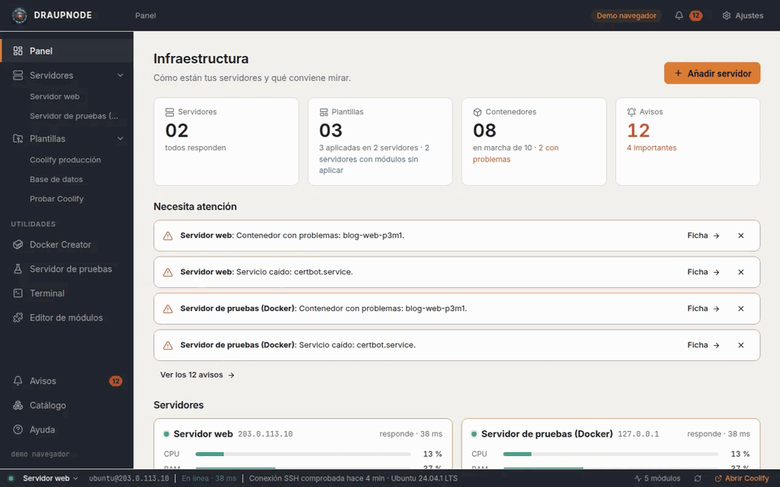
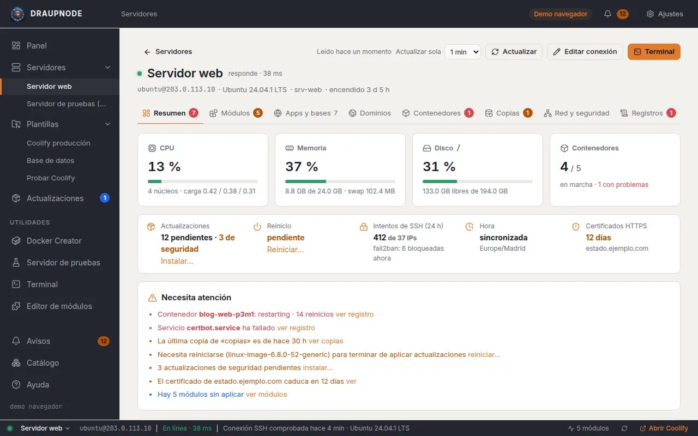
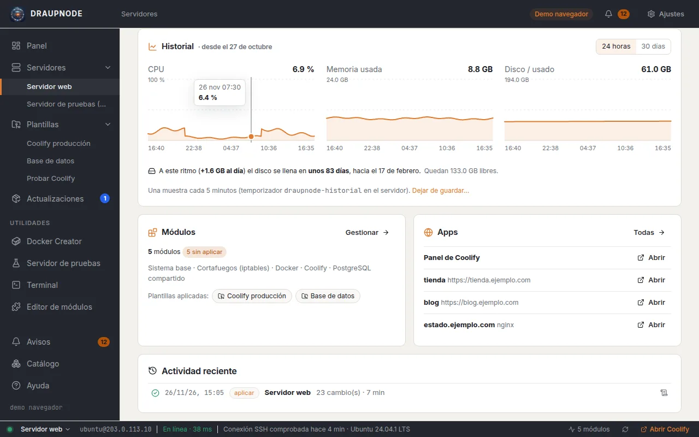
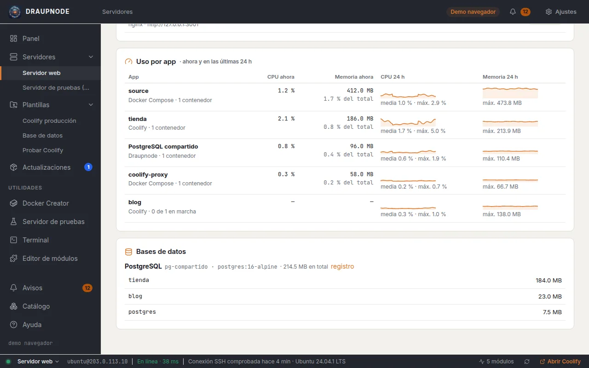
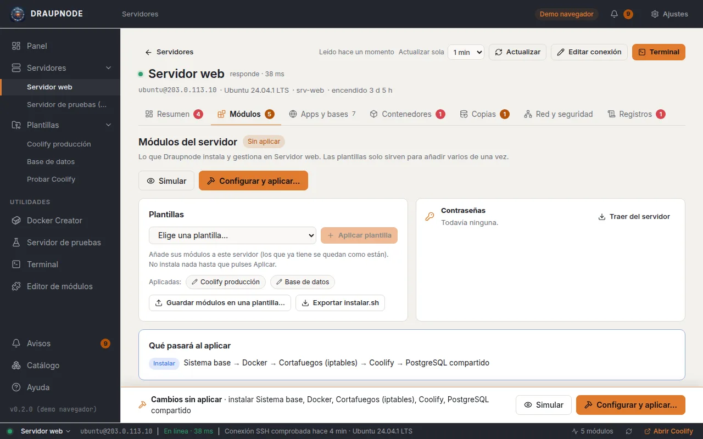
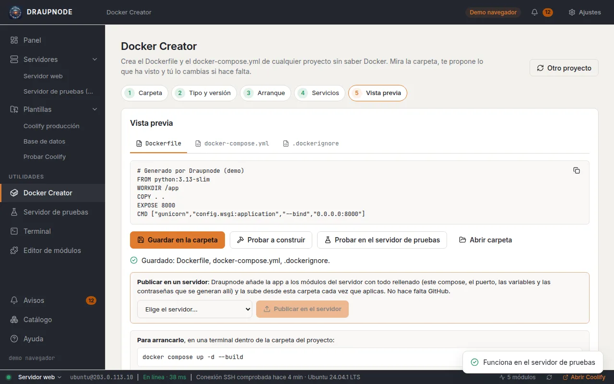
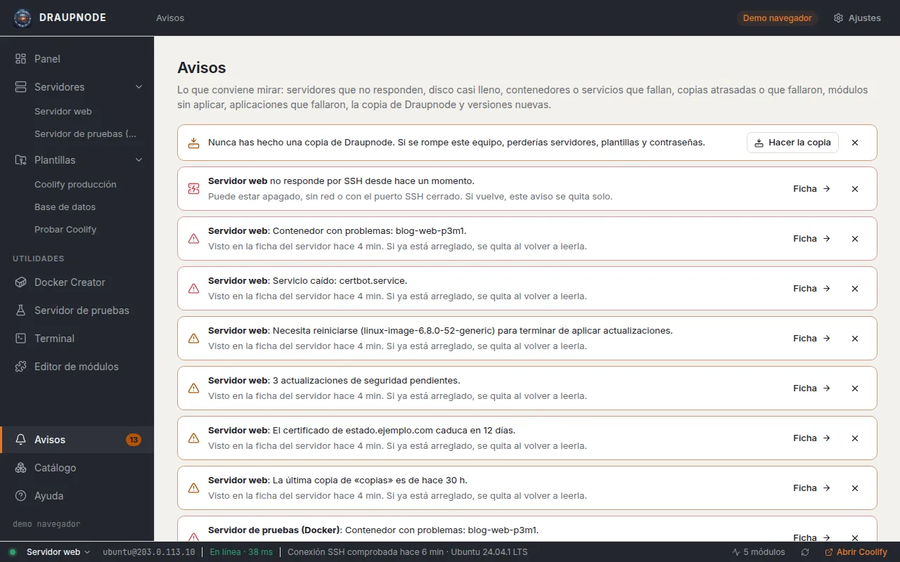

# Draupnode

> En la mitología nórdica, **Draupnir** es el anillo de oro forjado por los enanos Brokkr y Eitri:
> cada nueve noches nacen de él ocho anillos idénticos.
> **Draupnode** hace lo mismo con servidores: describes una vez lo que quieres y lo forja en cualquier máquina Linux, de cero.

Aplicación de escritorio (Windows, macOS y Linux) para preparar y vigilar servidores Linux:
das de alta tus servidores por SSH, eliges los **módulos** que quieres en cada uno (Docker, Caddy o nginx, copias con
restic, WireGuard, tus apps desde Git o desde una carpeta, Vaultwarden, Immich…) y Draupnode los instala con
**Ansible**, o te genera **un único `instalar.sh`**. Luego te enseña cómo está cada servidor y te avisa de lo que
conviene mirar.

<p align="center"></p>

**Todo es local.** No hay servidor de Draupnode: la configuración vive en tu equipo, las contraseñas en el llavero del
sistema o en una bóveda cifrada, y lo único que sale es la conexión SSH a *tus* servidores (y, si lo dejas activado,
una consulta anónima a GitHub para saber si hay versión nueva).

**Todo es de código abierto**, también lo que instala.

## Descargar

En [Releases](../../releases) están los instaladores de cada versión:

| Sistema | Fichero |
|---|---|
| Windows | `draupnode-X.Y.Z-windows-amd64-instalador.exe` (o el `.zip` con el `.exe` suelto) |
| macOS (Intel y Apple Silicon) | `draupnode-X.Y.Z-macos-universal.dmg` |
| Ubuntu / Debian | `draupnode_X.Y.Z_amd64.deb` (`sudo apt install ./draupnode_X.Y.Z_amd64.deb`) |
| Otros Linux | `draupnode-X.Y.Z-linux-amd64.tar.gz` (necesita GTK 3 y WebKitGTK 4.1) |

Los instaladores no están firmados: Windows (SmartScreen) y macOS (Gatekeeper) avisarán la primera vez.
En macOS: clic derecho sobre Draupnode → Abrir. En Windows: «Más información» → «Ejecutar de todas formas».

## Qué hace

- **Servidores**: alta por SSH (clave OpenSSH, PEM o PuTTY, con o sin contraseña, o usuario y contraseña) con huellas
  verificadas, y una **ficha** de cada uno por pestañas:
  - **Resumen**: CPU, memoria, disco, contenedores, actualizaciones, reinicio pendiente, intentos de SSH, hora,
    certificados y lo que «Necesita atención».
  - **Historial**: un temporizador en el servidor guarda cada 5 minutos CPU, memoria, disco y lo que gasta cada app
    (aunque Draupnode esté cerrado). Gráficas de 24 horas o 30 días y **cuándo se llenará el disco** a este ritmo.
  - **Apps y bases**: direcciones (también las de Coolify y los sitios de nginx/Caddy), **uso de cada app** (sus
    contenedores sumados) y bases de datos con lo que pesan.
  - **Contenedores** (parar, arrancar, ver registros, limpiar Docker), **Copias**, **Red y seguridad** (puertos,
    cortafuegos, IPs que intentan entrar, «Instalar actualizaciones» y «Reiniciar») y **Registros**.
- **Módulos del servidor**: marcas lo que quieres, lo **simulas** (qué cambiaría, sin tocar nada) y lo **aplicas**.
  Las contraseñas se generan en el propio servidor. Cada módulo se puede desinstalar, con o sin sus datos, y
  **«Desinstalar todo»** deja el servidor como recién preparado.
- **Plantillas**: conjuntos de módulos con su configuración para añadirlos de una vez a cualquier servidor.
- **Catálogo** de 50 módulos de código abierto, con su web, su código y su licencia, y una **guía para probar cada uno**
  en el servidor de pruebas (pasos y qué deberías ver), con una lista para ir marcando los que ya has comprobado:
  - **Sistema y red**: base, cortafuegos, SSH seguro con fail2ban, hora exacta (chrony), WireGuard, Caddy, nginx, AdGuard.
  - **Seguridad**: CrowdSec, Lynis, ClamAV, AIDE, auditd, Trivy, Keycloak, OpenBao.
  - **Contenedores y Kubernetes**: Docker, Coolify, Portainer, registro de imágenes, Kubernetes (k3s con Helm),
    Argo CD y OpenTofu (la continuación libre de Terraform).
  - **Bases de datos**: PostgreSQL, MariaDB y Valkey (la continuación libre de Redis) compartidos, y Adminer.
  - **Copias y monitorización**: restic con destino en otro servidor, Prometheus + Grafana, Loki, alertas al móvil,
    Uptime Kuma, Healthchecks, ntfy, Dozzle y Cockpit.
  - **Apps**: Nextcloud, Vaultwarden, Immich, Jellyfin, Navidrome, Paperless-ngx, Forgejo, Syncthing, Samba, Wiki.js,
    Vikunja, Umami y «Tu app».
- **Editor de módulos propios** (CodeMirror) para crear los tuyos o copiar uno incluido, y **exportarlos e importarlos**
  (un fichero `.draupnode-modulo`): al importar, Draupnode comprueba que esté entero y te enseña qué hace en el
  servidor (tareas, órdenes, descargas y lo delicado) antes de aceptarlo.
- **Tus apps**: el módulo «Tu app» despliega tu `docker-compose.yml` desde un repositorio de Git o **desde una carpeta
  de tu equipo** (sin saber git), lee las variables que necesita y genera sus claves. **Docker Creator** te hace el
  Dockerfile y el compose de tu proyecto (Python, Node, Java, PHP, Go, web) y lo prueba en un **servidor de pruebas**
  (Ubuntu en Docker en tu equipo).
- **Copias**: restic diario, «Traer copias al equipo», destino en otro servidor (rest-server en modo solo añadir, con
  rotación) y restaurar desde la app.
- **Avisos** en un solo sitio: servidores que no responden, disco que se va a llenar, contenedores o servicios que
  fallan, copias atrasadas, módulos sin aplicar, versión nueva.
- **Terminal SSH** integrada, con pestañas.
- **Adoptar** lo que ya hay: al aplicar deja en el servidor una ficha (sin contraseñas), así otro Draupnode (o este
  tras perder la configuración) puede recuperarla; y detecta las apps que ya no gestiona.
- **Copia de Draupnode**: exporta todo (servidores, plantillas, bóveda, claves) a un fichero cifrado e impórtalo en otro equipo.

| | |
|---|---|
|  |  |
| **Ficha del servidor**: su estado y lo que necesita atención | **Historial**: CPU, memoria y disco, y cuándo se llena |
|  |  |
| **Apps y bases**: lo que gasta cada app | **Módulos**: simular, aplicar y desinstalar |
|  |  |
| **Docker Creator**: el Dockerfile y el compose de tu proyecto | **Avisos**: todo lo que conviene mirar, en un sitio |

La ayuda de cada pantalla (botón «Ayuda») lo explica paso a paso, con capturas.

## Tecnología

- **Go** + **[Wails v2](https://wails.io)**: un solo ejecutable por sistema, sin servidor.
- Interfaz en **Svelte 5** + TypeScript; iconos Lucide; fuentes Inter y JetBrains Mono (incluidas, sin internet);
  terminal con xterm.js y editor con CodeMirror 6.
- SSH con `golang.org/x/crypto/ssh`; llavero con `zalando/go-keyring`; bóveda y copia cifradas con Argon2id + XChaCha20-Poly1305.
- **Ansible se ejecuta en el servidor** (en un entorno propio), así que no hace falta instalarlo en tu equipo, ni siquiera en Windows.

## Desarrollo

Go 1.26+ y Node 20+. En Linux, además, las librerías de WebKitGTK (una sola vez):

```bash
make deps-linux   # sudo apt install build-essential pkg-config libgtk-3-dev libwebkit2gtk-4.1-dev
make doctor       # wails doctor
```

| Comando | Qué hace |
|---|---|
| `make test` | Tests de Go (incluye un servidor SSH en memoria) + comprobación de tipos |
| `make dev` | App de escritorio con recarga en caliente |
| `make demo` | Solo la interfaz en el navegador, con datos simulados |
| `make capturas` | Rehace las capturas de la ayuda (necesita Chrome o Chromium) |
| `make gif` | Rehace el GIF del README con esas capturas (necesita Pillow) |
| `make build` | Ejecutable en `build/bin/draupnode` |
| `make install-linux` | Instala en tu usuario, sin sudo: menú de aplicaciones e icono en el dock |

**Publicar una versión**: cambia `Version` en `internal/app/app.go`, apúntalo en `docs/HISTORIAL.md` y sube una etiqueta
(`git tag v0.43.0 && git push origin v0.43.0`). GitHub Actions compila los instaladores de los tres sistemas y crea
la Release (`.github/workflows/release.yml`). En cada push a `main` se pasan los tests (`pruebas.yml`).

### Servidor de pruebas

Desde la app: «Servidor de pruebas» crea un Ubuntu 24.04 en Docker (con systemd y SSH) y lo da de alta.
O a mano: `bash pruebas/servidor-ubuntu/servidor.sh arrancar`.

## Estructura

```
main.go                  Arranque de Wails
internal/app             Métodos que llama la interfaz (un fichero por tema: servidores, plantillas, copias…)
internal/legal           Aviso de autoría y licencias que van dentro del ejecutable
internal/store           Configuración local (draupnode.json, permisos 0600)
internal/secrets         Llavero del sistema y bóveda cifrada
internal/copia           Copia cifrada de Draupnode (exportar/importar)
internal/sshx            Conexión SSH, huellas y comprobación del servidor
internal/modules         Catálogo: module.yaml + roles de Ansible (builtin/ va dentro del ejecutable)
internal/bundle          Genera el instalar.sh único (playbook + roles + callback, empaquetados)
internal/runner          Sube y ejecuta el instalar.sh por SSH, con eventos en directo
internal/overview        Scripts de la ficha del servidor (solo lectura) y del historial (temporizador)
internal/dockerize       Docker Creator
internal/lab             Servidor de pruebas
frontend/src/views       Pantallas
frontend/src/components  Piezas reutilizables
docs/                    PLAN.md (fases), HISTORIAL.md (cambios), GUIA_PUBLICAR.md e img/ (el GIF del README)
```

## Dónde guarda las cosas

| Qué | Dónde |
|---|---|
| Servidores, plantillas y ajustes | `~/.config/draupnode/draupnode.json` (Linux), `~/Library/Application Support/draupnode/` (macOS), `%AppData%\draupnode\` (Windows) |
| Huellas aceptadas | `known_hosts` en esa misma carpeta (también se lee `~/.ssh/known_hosts`) |
| Contraseñas | Llavero del sistema (servicio `draupnode`) o `vault.json` cifrado en la carpeta de configuración |
| Módulos propios | `modules/` en la carpeta de configuración |
| Registros de cada ejecución | `runs/` en la carpeta de configuración (los 60 últimos por plantilla y servidor) |
| En cada servidor | `/etc/draupnode/secretos/<plantilla>/` (contraseñas generadas, solo root), `/etc/draupnode/plantillas/` (ficha sin contraseñas), `/srv/draupnode/apps/` (datos de las apps), `/var/lib/draupnode/historial/` (historial, si lo activas) |

## Publicar tu app

Guía paso a paso (crear los ficheros de Docker, publicar en un servidor, revisar la configuración y subir, con o sin GitHub): [docs/GUIA_PUBLICAR.md](docs/GUIA_PUBLICAR.md).

## Licencia

Copyright © 2026 Francisco Javier Pradas.

Draupnode es **software libre y gratuito** bajo la licencia
[GNU GPL v3.0 o posterior](LICENSE): puedes usarlo, estudiarlo, modificarlo y compartirlo, y
quien reparta una copia (modificada o no) tiene que hacerlo con las mismas libertades y su código
fuente. Se ofrece **sin ninguna garantía**.

Términos adicionales (sección 7 de la GPL): hay que conservar el aviso de autoría y el enlace a este
proyecto en Ajustes («Acerca de Draupnode») y en este README, y una versión modificada debe indicar
que lo está. Todo esto está en [COPYRIGHT](COPYRIGHT).

Las librerías que van dentro de la app tienen sus propias licencias libres, compatibles con la GPL
(MIT, BSD, Apache-2.0, ISC y OFL para las fuentes): están en
[internal/legal/terceros.txt](internal/legal/terceros.txt) y en Ajustes → «Licencias»
(se rehace con `make licencias`). Los programas que Draupnode instala en tus servidores no forman
parte de Draupnode: cada módulo del Catálogo enseña la licencia y la web de lo que instala, y todos
son de código abierto.
