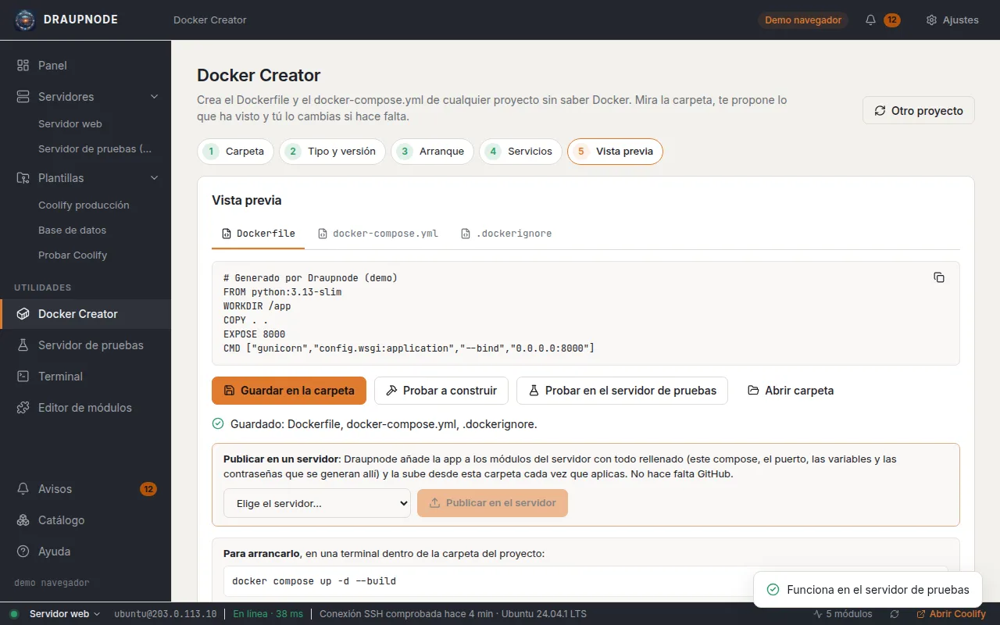
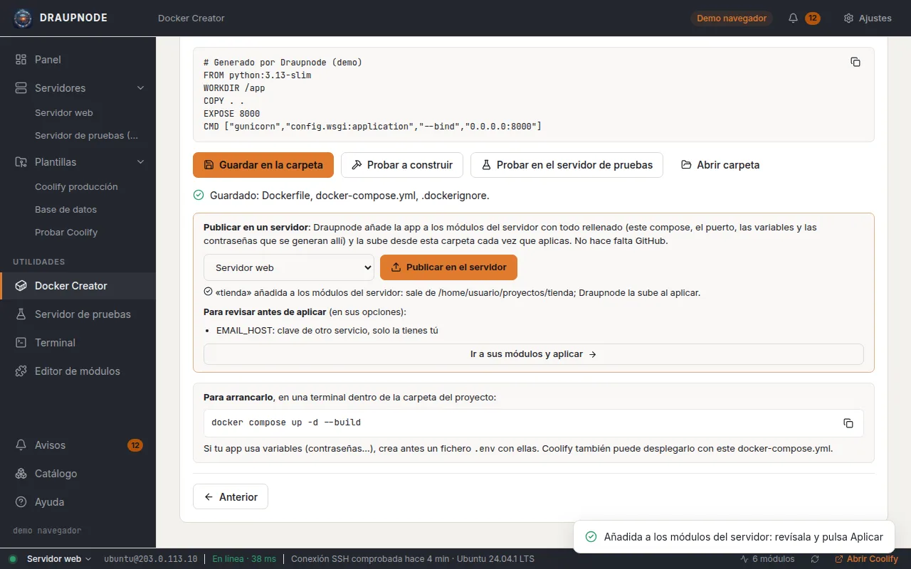
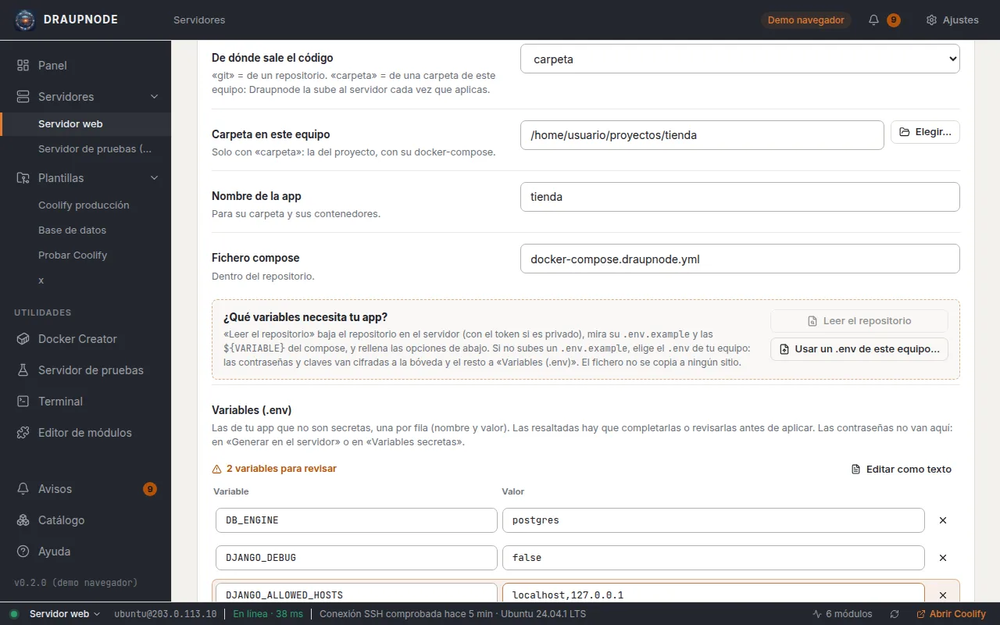

# Publicar tu app paso a paso

> Esta guía es la misma que sale en la ayuda de Draupnode («Publicar tu app paso a paso»).

Cómo pasar un proyecto de tu ordenador a un servidor funcionando, sin saber de Docker ni de git: crear los ficheros de Docker, publicarlo, revisar su configuración y subirlo. Probado con una app Django real (base de datos PostgreSQL, claves de cifrado, 110 migraciones) en el servidor de pruebas.

## 1 · Antes de empezar

Necesitas el servidor dado de alta en Servidores (y que responda) y la carpeta de tu proyecto en este equipo. Si tu proyecto tiene un .env.example con sus variables, mejor; si no, Draupnode las saca del código. El .env (con tus contraseñas de verdad) nunca se lee ni se sube.

## 2 · Crear los ficheros de Docker

Utilidades → Docker Creator → «Elegir carpeta». Draupnode reconoce el lenguaje (Python/Django, Node, Java, PHP/Laravel, Go…), la base de datos que usa y sus variables, también las que lee el código aunque no estén en .env.example, y en qué formato van sus claves (por ejemplo, una clave Fernet). Revisa lo reconocido; en «Servicios», si usa PostgreSQL, puedes elegir «PostgreSQL compartido» (el del servidor, para todas tus apps) en vez de uno propio. Pulsa «Siguiente» hasta la vista previa y «Guardar en la carpeta». Si tu proyecto ya tenía Dockerfile o compose, los nuevos se guardan al lado (.draupnode) sin tocar los tuyos.

## 3 · Probarlo (opcional)

«Probar en el servidor de pruebas» lo arranca en el servidor de pruebas de este equipo y te deja abrirlo en el navegador. Si funciona allí, funcionará en tu servidor.

## 4 · Publicar en un servidor

Debajo, en «Publicar en un servidor», elige el servidor y pulsa «Publicar en el servidor». Draupnode añade la app a los módulos de ese servidor con todo rellenado: de dónde sale el código (esta carpeta), el compose, un puerto libre (solo dentro del servidor, 127.0.0.1), las variables con los valores de servidor de su tipo de app (Django: DEBUG=false y sus hosts; Laravel: APP_ENV=production y APP_KEY en su formato; Rails: RAILS_ENV y SECRET_KEY_BASE; Node: NODE_ENV=production…), y las contraseñas y claves que se generarán en el servidor, cada una en su formato. Con «PostgreSQL compartido», Draupnode añade ese módulo al servidor si falta, le crea una base y un usuario con el nombre de la app y le pasa los datos de conexión. Las variables sin valor no se ponen (vacías pisarían el valor por defecto de la app); eso y lo que no puede saber (el correo, contraseñas de otros servicios…) te lo lista en «Para revisar». Todavía no instala nada.

## 5 · Revisar su configuración

«Ir a sus módulos y aplicar» te lleva a la ficha del servidor → Módulos. Abre «Tu app (Git o carpeta)»: «De dónde sale el código» = carpeta (con «Elegir…» para cambiarla). En «Variables (.env)», una fila por variable: las resaltadas son las que hay que completar o revisar, con el motivo. Las contraseñas no van ahí: «Generar en el servidor» (NOMBRE, o NOMBRE:fernet / :base64-32 / :hex-32 si la app exige formato) o «Variables secretas» (las que solo tienes tú: correo, claves de pago…). Si la imagen no prepara la base de datos al arrancar, pon «Orden después de arrancar» (por ejemplo, python3 manage.py migrate).

## 6 · Simular y aplicar

«Simular» no toca nada: dice qué se haría y avisa de lo que fallaría (variables sin valor, puertos abiertos a internet…). «Aplicar» (abajo, en la barra fija) sube la carpeta al servidor (sin .git, .env, entornos virtuales ni node_modules, ni lo de su .dockerignore), construye la app enseñando el progreso en directo, la arranca, comprueba que los contenedores siguen en marcha y que responde, y guarda en tu bóveda las contraseñas que se generaron en el servidor. La primera vez tarda unos minutos.

## 7 · Abrir la app

Ficha del servidor → Apps (o Resumen) → «Abrir»: se abre en tu navegador por un túnel SSH, sin estar abierta a internet. Para publicarla en internet con tu dominio y HTTPS, añade el módulo Caddy (o nginx) y pon el dominio en la app; el dominio tiene que apuntar a la IP del servidor.

## 8 · Actualizarla

Cambia el código en tu equipo y vuelve a pulsar «Aplicar» en los módulos del servidor: sube lo nuevo, reconstruye y reinicia. Los datos (la base de datos, los ficheros subidos) están en volúmenes de Docker y no se pierden.

## 9 · Si algo falla

El aviso del final dice en qué paso se paró y por qué (por ejemplo, «la orden después de arrancar falló» con sus últimas líneas) y, si reconoce el error, una línea «Qué significa» con la causa probable (una base que no existe, una contraseña que no coincide, un puerto ocupado, una librería que falta, una clave con formato equivocado…). En la ficha → Contenedores tienes el registro de cada contenedor y botones para reiniciarlo. Errores típicos: una variable vacía que pisa el valor por defecto de la app (quítala), un valor de desarrollo (DEBUG=true, NODE_ENV mal escrito) o una clave con el formato equivocado (usa :fernet, :base64-32…).

## Con GitHub en vez de una carpeta

Si tu proyecto está en GitHub (u otro Git), en «Tu app (Git o carpeta)» elige «git», pon la dirección del repositorio y, si es privado, un token de solo lectura. «Leer el repositorio» saca sus variables y el tipo de app. Cada vez que apliques, baja lo último de la rama.
